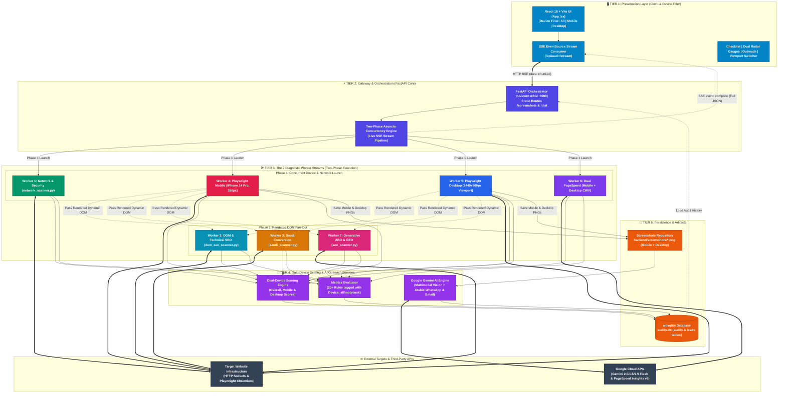

# 🏛️ WebAudit Pro — System Architecture Document

**Version:** 2.0.0  
**Status:** Production Ready  
**Architecture Type:** Dual-Device (Mobile + Desktop), Local-First, Zero-Cloud-Cost 7-Worker Diagnostic Platform  
**Author:** WebAudit Pro Engineering Team  
**Last Updated:** October 2026  

---

## 📑 Table of Contents
1. [Executive Summary](#1-executive-summary)
2. [High-Level System Topology](#2-high-level-system-topology)
3. [Component Architecture by Tier](#3-component-architecture-by-tier)
   * 3.1 [Presentation Tier (React + Vite + Device Filter)](#31-presentation-tier-react--vite--device-filter)
   * 3.2 [API Orchestration Tier (FastAPI + Asyncio)](#32-api-orchestration-tier-fastapi--asyncio)
   * 3.3 [The 7 Diagnostic Worker Streams Matrix](#33-the-7-diagnostic-worker-streams-matrix)
   * 3.4 [Dual-Device Scoring & AI Outreach Services](#34-dual-device-scoring--ai-outreach-services)
   * 3.5 [Persistence & Asset Storage (SQLite & Dual Screenshots)](#35-persistence--asset-storage-sqlite--dual-screenshots)
4. [Asynchronous Data Flow & SSE Pipeline](#4-asynchronous-data-flow--sse-pipeline)
5. [Database Schema & Data Models](#5-database-schema--data-models)
6. [External Integrations & Fallback Mechanics](#6-external-integrations--fallback-mechanics)
7. [Fault Isolation & Resilience Design](#7-fault-isolation--resilience-design)
8. [Deployment & Local Operational Profile](#8-deployment--local-operational-profile)

---

## 1. Executive Summary

**WebAudit Pro** is an asynchronous, dual-device website diagnostic and automated sales lead generation platform. Engineered for digital agencies and conversion consultants targeting enterprise clients (with dedicated localization for Saudi Arabia and the GCC), the platform executes parallel technical, UX, and conversion audits simultaneously across both **Mobile (390px iPhone 14 Pro)** and **Desktop (1440px)** viewports:

1. **Network & Security Protocol** (TLS socket handshake, SSL validity, TTFB, 301/308 redirect enforcement).
2. **DOM & Technical SEO** (Headings hierarchy, meta descriptions, image alts, tracking scripts, and technical stack).
3. **Saudi & GCC Conversion Optimization** (WhatsApp links, click-to-call, Saudi gateways like Mada/STC Pay/Tabby/Tamara, Arabic RTL orientation).
4. **Headless Mobile Viewport Simulation** (Playwright iPhone 14 Pro emulation, touch target ergonomics < 48px, horizontal layout overflow, mobile hero screenshot).
5. **Headless Desktop Viewport Simulation** (Playwright 1440px desktop viewport, desktop layout overflow, desktop hero screenshot, rendered dynamic DOM extraction).
6. **Dual PageSpeed Core Web Vitals** (Google PageSpeed Insights v5 REST API for both Mobile & Desktop Core Web Vitals: FCP, Speed Index, TBT, LCP, CLS, INP).
7. **AI Search Engine Optimization (AEO & GEO)** (AI bot crawl permissions, Schema.org entity linking, RAG direct-answer chunkability).

---

## 2. High-Level System Topology

---

## 3. Component Architecture by Tier

### 3.1 Presentation Tier (React + Vite + Device Filter)
Located in `frontend/src/`:
* **Device Filter System:** Users can filter the entire checklist and analytics radar by `deviceFilter: 'all' | 'mobile' | 'desktop'`.
* **Dual Viewport Switcher:** Interactive device mock container switching between iPhone 14 Pro (390px) and Desktop (1440px) with interactive tap target and layout overflow overlays.
* **Dual Scorecards:** Displays `overall_score`, `mobile_overall_score`, and `desktop_overall_score` side-by-side.

### 3.2 API Orchestration Tier (FastAPI + Asyncio)
Located in `backend/main.py`:
* Concurrently fires `scan_headless_devices(target_url, audit_id, screenshots_dir)` which launches both mobile and desktop browser contexts inside an incognito Chromium instance.
* Streams SSE events for all workers (`mobile`, `desktop`, `network`, `external`, `dom_seo`, `saudi`, `aeo_geo`).

### 3.3 The 7 Diagnostic Worker Streams Matrix

| # | Worker Stream | Module File | Inspection Scope & Diagnostics | Device Relevancy |
|---|---|---|---|---|
| **1** | **Network & Security** | `network_scanner.py` | Direct TLS 1.2/1.3 socket handshake on port 443; SSL expiration days countdown; HTTP $\to$ HTTPS permanent redirect (301/308); TTFB latency; CDN identification. | All Devices |
| **2** | **DOM & Technical SEO** | `dom_seo_scanner.py` | Meta title & description length; H1 single hierarchy; image alt text coverage; robots.txt & sitemap.xml presence; pixels (GA4, GTM, Meta, Snapchat, TikTok). | All Devices |
| **3** | **Saudi Conversion** | `saudi_scanner.py` | Direct WhatsApp lead triggers (`wa.me`); click-to-call phone tags (`tel:`); Saudi payment gateways (Mada, Apple Pay, STC Pay, Tabby, Tamara); Arabic RTL orientation. | All Devices |
| **4** | **Playwright Mobile** | `mobile_browser.py` | Emulates iPhone 14 Pro (390×844px, DPR 3.0); touch targets < 48px; mobile layout overflow (`scrollWidth > clientWidth`); mobile fold & full PNGs. | Mobile |
| **5** | **Playwright Desktop** | `mobile_browser.py` | Emulates Desktop Viewport (1440×900px); desktop horizontal scroll overflow; desktop fold & full PNGs; extracts rendered SPA DOM. | Desktop |
| **6** | **Dual PageSpeed Vitals** | `external_intel.py` | Google PageSpeed Insights REST API querying both Mobile and Desktop Lighthouse: FCP, Speed Index, TBT, LCP, CLS, INP, and WebP compression savings. | Mobile & Desktop |
| **7** | **Generative AEO & GEO** | `aeo_scanner.py` | AI crawler directives in robots.txt (GPTBot, PerplexityBot, ClaudeBot); Schema.org JSON-LD structured data with `sameAs` entity links; RAG chunkability. | All Devices |

### 3.4 Dual-Device Scoring & AI Outreach Services
* **Device-Aware Deductions (`scoring_engine.py`):**
  * Mobile score ignores Desktop UX issues.
  * Desktop score ignores Mobile UX issues (tap targets, mobile overflow).
* **Multi-Model Gemini Fallback (`ai_pitch_engine.py`):**
  * Tries `gemini-2.0-flash`, `gemini-1.5-flash`, and `gemini-2.5-flash` with the mobile or desktop fold hero screenshot.
  * Instant fallback to high-converting deterministic Arabic WhatsApp, English cold email, and sales discovery scripts.

---
*Updated for WebAudit Pro Dual-Device Architecture.*
